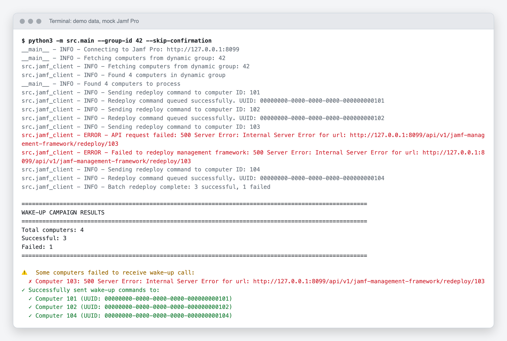
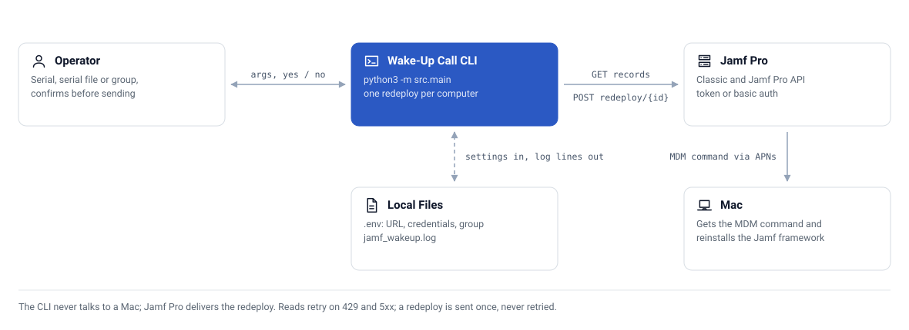
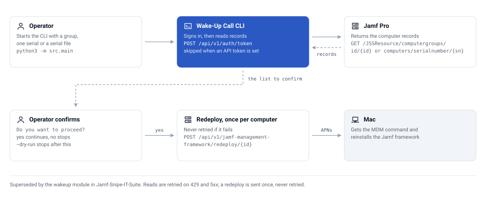

<div align="center">


# ⏰ Jamf WakeUp Call

**Wake the Macs that stopped checking in to Jamf Pro: redeploy the management framework by group, serial or file, with a dry run first**


[](https://github.com/CaputoDavide93/Jamf-WakeUp-Call/actions/workflows/ci.yml)

</div>

---

> [!IMPORTANT]
> **Superseded.** The same wake-up and redeploy logic now lives in **[Jamf-Snipe-IT-Suite](https://github.com/CaputoDavide93/Jamf-Snipe-IT-Suite)** as the `wakeup` module (`src/modules/maintenance/wakeup.py`), with retries and SSM-backed credentials. Use that for new work. This repo is kept for reference and receives fixes only.

---

## ✨ Features

Some Macs go quiet: MDM commands queue and nothing happens. Jamf WakeUp Call is a small Python command line tool for Jamf Pro administrators. Give it a dynamic group, a serial number or a file of serials, and it asks Jamf Pro to redeploy the Jamf management framework on each of those computers.

### Why it exists

A Mac that sleeps through its check-ins, or whose framework has gone stale, stops acting on policies and commands. The Jamf Pro API has a call that redeploys the framework. For forty Macs that means forty computer ID lookups and forty requests by hand, with no preview and no tally of which ones took.

This tool looks the computers up, shows you the list, sends the commands and prints one result per computer, with the command UUID Jamf Pro returns.

| | Jamf WakeUp Call | A one-off curl or script |
|---|---|---|
| Target a whole dynamic group | Yes, `--group-id` | Only if you write the lookup |
| Target a serial list | Yes, `--file`, with `#` comments | Only if you write the loop |
| Preview the targets | `--dry-run` and a yes/no prompt | Only if you write it |
| Per-computer result | Success or failure line, with the command UUID | Only if you parse the responses |
| Retries | Reads retry on `429` and `5xx` over HTTPS; the redeploy POST is never retried | Whatever you write |
| Token handling | Static API token, or username and password with automatic refresh | Whatever you write |

The one trade-off: the tool only asks Jamf Pro to queue the command. It cannot see whether a Mac received it, so a Mac that stays offline or cannot reach Apple's push service still does not wake until it can.

### Install in 3 steps

You need Python 3 with `pip`, a Jamf Pro account or API token that can read computers and computer groups and send the redeploy command, and the URL of your Jamf Pro server.

1. **Get the code and its dependencies.**

   ```bash
   git clone https://github.com/CaputoDavide93/Jamf-WakeUp-Call.git
   cd Jamf-WakeUp-Call
   pip install -r requirements.lock.txt
   ```

2. **Point it at your Jamf Pro.** Copy the template and fill in the URL and either a token or a username and password.

   ```bash
   cp .env.example .env
   ```

3. **Preview, then send.** Run from the repository root.

   ```bash
   python3 -m src.main --group-id 42 --dry-run     # preview, sends nothing
   python3 -m src.main --group-id 42               # asks for yes/no, then sends
   ```

Never run a first test on production Macs. Try one serial first: `python3 -m src.main C02EXAMPLE001 --dry-run`. The [setup guide](docs/setup.md) walks through every step.

<picture>
  <source media="(prefers-color-scheme: dark)" srcset="docs/assets/screenshots/wake-group-dark.png">
  
</picture>

*Real output of the tool against a local mock of Jamf Pro with made-up computers, not a live tenant. Retake with `make screenshots`.*

### What you get

| | Feature | What it does |
|---|---|---|
| 🎯 | Three ways to pick targets | A dynamic group, a single serial number, or a file with one serial per line |
| 🛟 | Look before you send | `--dry-run` lists what would happen and sends nothing; every mode asks yes/no unless you pass `--skip-confirmation` |
| 🧾 | Clear results | A summary of totals, then one line per computer with its command UUID or its error |
| 🔑 | Two ways to authenticate | A bearer token, or username and password with a token fetched and refreshed for you |
| 🔁 | Safe retries | Reads retry up to 3 times with backoff on `429` and `5xx` over HTTPS; the redeploy POST is never retried, so no command is sent twice |
| 🧱 | Placeholder guard | Values left unedited from `.env.example` count as unset, so the tool never calls a fake server |

---

## 🗺️ Architecture

<picture>
  <source media="(prefers-color-scheme: dark)" srcset="docs/assets/architecture-dark.svg">
  
</picture>

The script never talks to a Mac directly. It asks Jamf Pro to redeploy the management framework, and Jamf Pro delivers that as an MDM command the next time the Mac is reachable.

One wake-up, call by call:

<picture>
  <source media="(prefers-color-scheme: dark)" srcset="docs/assets/wake-sequence-dark.svg">
  
</picture>

Redraw both with `python3 tools/gen_diagram.py`; CI runs `python3 tools/gen_diagram.py --check` and fails if a committed SVG is stale. The full walk-through is in [how it works](docs/how-it-works.md).

---

## 🧭 Tested on

| Item | Status |
|---|---|
| Python 3.12 on Linux | Tested: the CI run executes the pytest suite and the diagram check |
| Python 3.14 on macOS | Tested: the test suite, and the CLI against the local mock of Jamf Pro used for the screenshots |
| Python 3.9 to 3.11 | Unverified. The lockfile is compiled for 3.9, but nothing here runs on it |
| A real Jamf Pro server | Unverified in this repo's tests. The endpoints and response shapes follow the Jamf Pro Classic and Jamf Pro APIs; the mock cannot prove a live tenant behaves the same |
| Jamf Pro versions | Unverified: no version has been recorded |
| Managed Macs, macOS versions | Unverified: the tool never talks to a Mac, so this depends on Jamf Pro and the Mac |

Ran it on something not listed? Say so in an [environment report](https://github.com/CaputoDavide93/Jamf-WakeUp-Call/issues/new?template=environment-report.yml); [CONTRIBUTING.md](CONTRIBUTING.md) lists what to attach.

---

## 🚀 Quick Start

The three steps are at the top. After that:

```bash
python3 -m src.main                                # the group in JAMF_DYNAMIC_GROUP_ID
python3 -m src.main --group-id 42                  # another group
python3 -m src.main C02EXAMPLE001                  # one computer by serial number
python3 -m src.main --file computers.txt           # many serials from a file
python3 -m src.main --file computers.txt --dry-run # preview first
```

Every flag, the file format and example output are in [usage](docs/usage.md). Every environment variable is in [configuration](docs/configuration.md).

---

## 📚 Docs

| Doc | What is in it |
|---|---|
| [Setup](docs/setup.md) | Numbered walkthrough from clone to a first dry run, with output |
| [Usage](docs/usage.md) | The three modes, every flag, the serial file format, exit codes |
| [Configuration](docs/configuration.md) | Every environment variable and the placeholder rule |
| [How it works](docs/how-it-works.md) | Authentication, the API calls, retries, what a result means |
| [Troubleshooting](docs/troubleshooting.md) | Symptoms and fixes |
| [FAQ](docs/faq.md) | Short answers to common questions |
| [Docs index](docs/README.md) | The same list, in reading order |

---

## 📁 Repo structure

```text
Jamf-WakeUp-Call/
├── src/
│   ├── main.py             # 🎛️ CLI and orchestration (run with python3 -m src.main)
│   ├── jamf_client.py      # 🔌 Jamf Pro API client
│   └── config.py           # ⚙️ configuration from the environment
├── tests/                  # ✅ pytest: config placeholders, diagrams, docs links
├── tools/
│   ├── gen_diagram.py      # 🖌️ redraws docs/assets/*.svg
│   ├── brand/              # 🎨 vendored icon and social preview generator, icon freshness check
│   └── screenshots/        # 📸 demo mock of Jamf Pro and the screenshot script
├── docs/                   # 📚 setup, usage, configuration, how it works, troubleshooting, FAQ
│   └── assets/             # 🗺️ diagrams, screenshots, brand icon, social preview
├── .github/                # 🤖 ci.yml and the environment report issue form
├── Makefile                # 🧰 make check, screenshots, social-preview
├── llms.txt                # 🤖 the project in one plain-text page for search engines
├── requirements*.txt       # 📜 ranges, hashed lockfile, dev extras
├── .env.example            # ⚙️ configuration template
├── AGENTS.md               # 🧭 agent and contributor instructions
└── LICENSE  SECURITY.md  CONTRIBUTING.md   # 📄 community files
```

---

## 🧪 Testing

```bash
make venv     # creates .venv with the dev requirements
make check    # pytest, the diagram check and the icon check
```

Regenerate the lockfile after changing `requirements.txt`:

```bash
uv pip compile requirements.txt -o requirements.lock.txt --python-version 3.9 --generate-hashes
```

---

## 🛠️ Troubleshooting

The common failures (401, computer not found, connection refused, names shown as `Unknown`) are in [docs/troubleshooting.md](docs/troubleshooting.md). Set `LOG_LEVEL=DEBUG` and read the log file named by `LOG_FILE` (default `jamf_wakeup.log`) for detail.

---

## 🔒 Security

See [SECURITY.md](SECURITY.md) for how to report a vulnerability and what the tool stores. Use a dedicated API account with the least privilege that works, keep `.env` and the log file readable only by you, and run `--dry-run` first.

---

## 🤝 Contributing

Bug reports, fixes and environment reports are welcome; see [CONTRIBUTING.md](CONTRIBUTING.md). Test in a non-production environment before using the tool on production Macs. It is provided as is.

---

## 📄 License

MIT. See [LICENSE](LICENSE).

---

<p align="center"><sub>Made with ❤️ by <a href="https://github.com/CaputoDavide93">Davide Caputo</a></sub></p>
