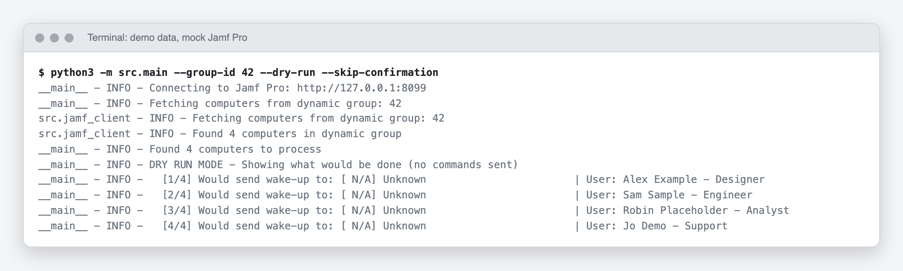
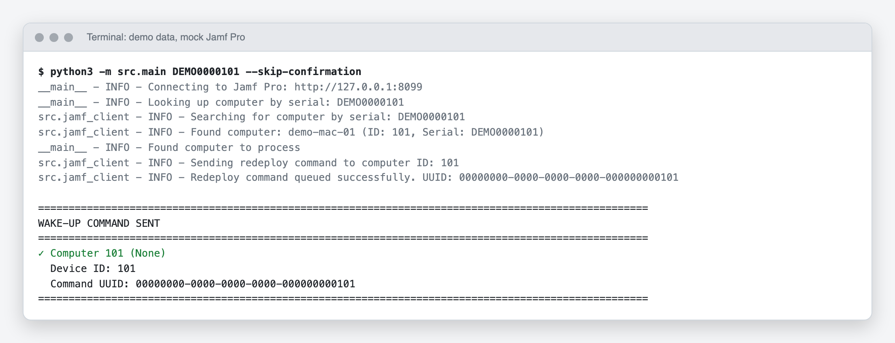

# Setup

This walks from a fresh clone to a first real wake-up. The screenshots show the tool's real output against a local mock of Jamf Pro with made-up computers (see [how the screenshots are made](how-it-works.md#about-the-screenshots)).

## What you need

- Python 3 and `pip`.
- The URL of your Jamf Pro server, for example `https://jamf.example.com`.
- An API token, or a username and password, for an account that can read computers and computer groups and send the management framework redeploy command. The exact Jamf Pro privilege names are unverified here; start from read access to computers and computer groups and add the redeploy permission the API reports as missing.
- Either the ID of a dynamic computer group, or the serial numbers of the Macs you want to wake.

## 1. Get the code

```bash
git clone https://github.com/CaputoDavide93/Jamf-WakeUp-Call.git
cd Jamf-WakeUp-Call
```

## 2. Install the dependencies

```bash
pip install -r requirements.lock.txt
```

The lockfile pins and hash-checks the two runtime packages (`requests` and `python-dotenv`). Use a virtual environment if you like: `python3 -m venv .venv && . .venv/bin/activate` first.

## 3. Configure the connection

```bash
cp .env.example .env
```

Edit `.env`. Set `JAMF_PRO_URL`, then either `JAMF_PRO_API_TOKEN`, or `JAMF_PRO_USERNAME` and `JAMF_PRO_PASSWORD`. Set `JAMF_DYNAMIC_GROUP_ID` if you plan to use group mode without typing the ID each time.

```env
JAMF_PRO_URL=https://jamf.example.com
JAMF_PRO_API_TOKEN=paste-your-token-here
JAMF_DYNAMIC_GROUP_ID=42
```

Any value that still starts with an `.env.example` placeholder (`your_`, `your-`, `dev_`, `https://your-`) counts as unset, and the tool stops with a message instead of calling a fake server. `.env` is git-ignored. The full list of variables is in [configuration](configuration.md).

## 4. Preview a group

```bash
python3 -m src.main --group-id 42 --dry-run
```

The tool fetches the group, then asks `Do you want to proceed? (yes/no)`. Answer `yes` to see the preview; nothing is sent in dry-run mode. Add `--skip-confirmation` to skip the question. The preview lists each computer with the user Jamf Pro has on record.

<picture>
  <source media="(prefers-color-scheme: dark)" srcset="assets/screenshots/dry-run-group-dark.png">
  
</picture>

The `N/A` and `Unknown` in the list are a known display quirk, explained in [troubleshooting](troubleshooting.md#the-computer-list-shows-n-a-and-unknown). The targets themselves are right.

## 5. Wake one computer first

Before a whole group, try one Mac you can watch. Use its serial number:

```bash
python3 -m src.main DEMO0000101
```

Answer `yes` at the prompt. The result block shows the device ID and the command UUID Jamf Pro returned.

<picture>
  <source media="(prefers-color-scheme: dark)" srcset="assets/screenshots/wake-serial-dark.png">
  
</picture>

A command UUID means Jamf Pro accepted the command. It does not mean the Mac has acted on it yet. In the Jamf Pro web interface, check the computer's management history to see when it completes.

## 6. Wake the group

```bash
python3 -m src.main --group-id 42
```

Review the list, answer `yes`. The tool prints totals, then one line per computer. The exit code is `0` when every computer succeeded and `1` when any failed.

<picture>
  <source media="(prefers-color-scheme: dark)" srcset="assets/screenshots/wake-group-dark.png">
  
</picture>

For automation, add `--skip-confirmation`. Read [usage](usage.md) first, and run with `--dry-run` before the first scheduled run.

## 7. Check the log

Every run appends to the file named by `LOG_FILE` (default `jamf_wakeup.log` in the directory you ran from). It records computer IDs and serial numbers, so treat it as internal data. Set `LOG_LEVEL=DEBUG` for request-level detail.

## Next

- [Usage](usage.md) for every flag and the file format.
- [Troubleshooting](troubleshooting.md) when a step fails.
